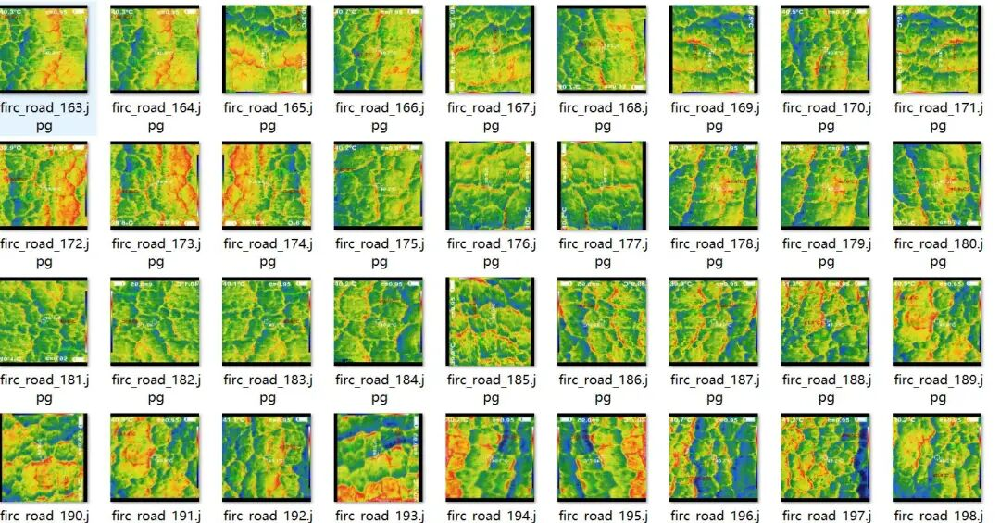
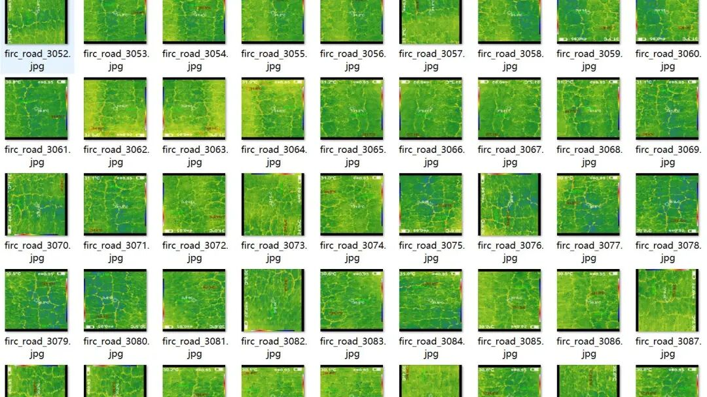
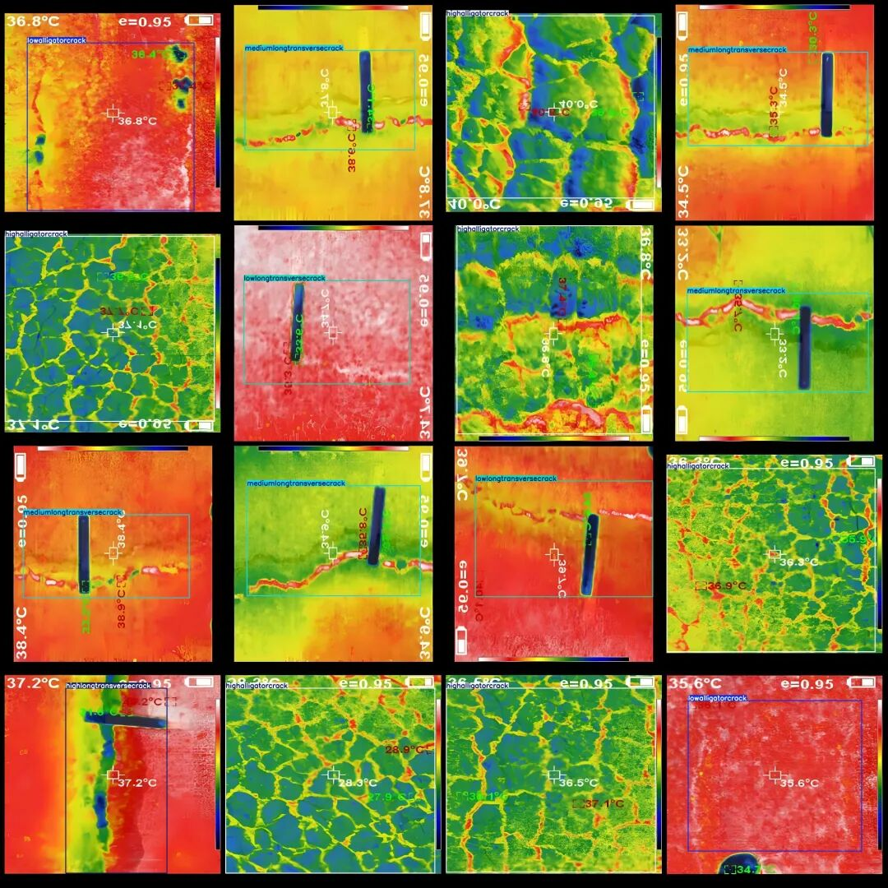
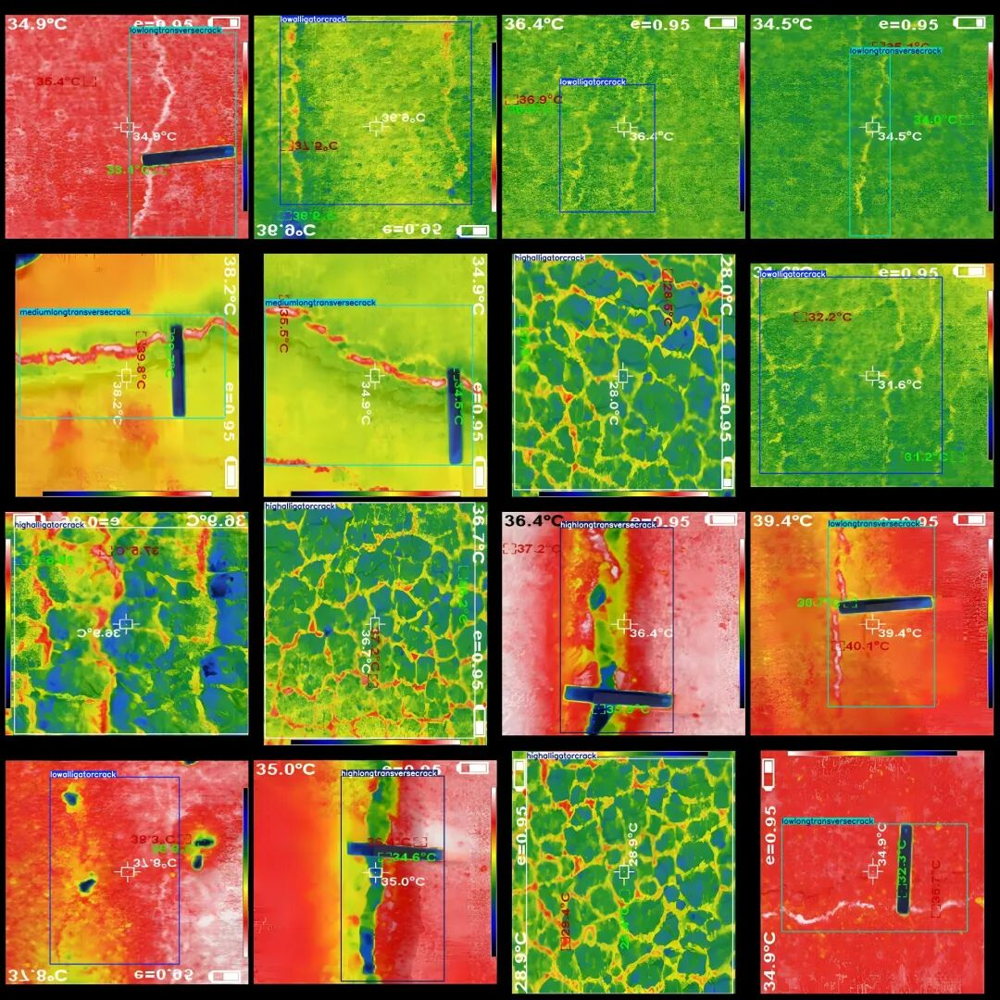

# Intelligent Traffic Infrared Thermal Imaging Road Pavement Cracks Severity Detection Dataset VOC+YOLO Format with 3437 Images in 6 Categories

Dataset format: Pascal VOC format + YOLO format (txt file without split path, only containing jpg images and corresponding VOC format xml files and yolo format txt files)

Number of images (number of jpg files): 3437

Number of annotations (number of xml files): 3437

Number of annotations (number of txt files): 3437

Label count: 6

Label category names (Note that the order of yolo format categories does not correspond to this, but is based on the labels folder's classes.txt): ["highalligatorcrack", "highlongtransversecrack", "lowalligatorcrack", "lowlongtransversecrack", "mediumalligatorcrack", "mediumlongtransversecrack"]

Number of boxes labeled in each category:

High alligator crack (severe crazing) frame count = 819, occupying picture count = 819.

Highlongtransversecrack (heavy transverse crack) frame count = 280, occupying picture count = 280

Lowalligatorcrack (Mild Turtle Crack) frame count = 954, occupying picture count = 954.

Lowlongtransversecrack (Mild Transverse Crack) frame count = 298, occupying picture count = 298

Medium alligator crack (moderate crater) frame count = 364, occupying picture count = 364.

Medium-long transverse crack (moderate longitudinal crack) frame count = 722, occupying picture count = 722

Total frames: 3437

Image resolution: 1280x1280

Using labelImg:

Annotation rules: Draw a rectangle around the category.

Important Notice: The dataset does not have separate training, validation, and test sets; you need to partition them yourself.

Special : This dataset does not guarantee the accuracy of the trained models or weight files.

Image Preview:

Annotation example:

## Payment

Here is a pay link on Stripe ( https://buy.stripe.com/3cs8yP7sY87d0vu9AB ). Please contact me lonlonago@foxmail.com after funding $89, and I will send you a complete data files , thank you!

